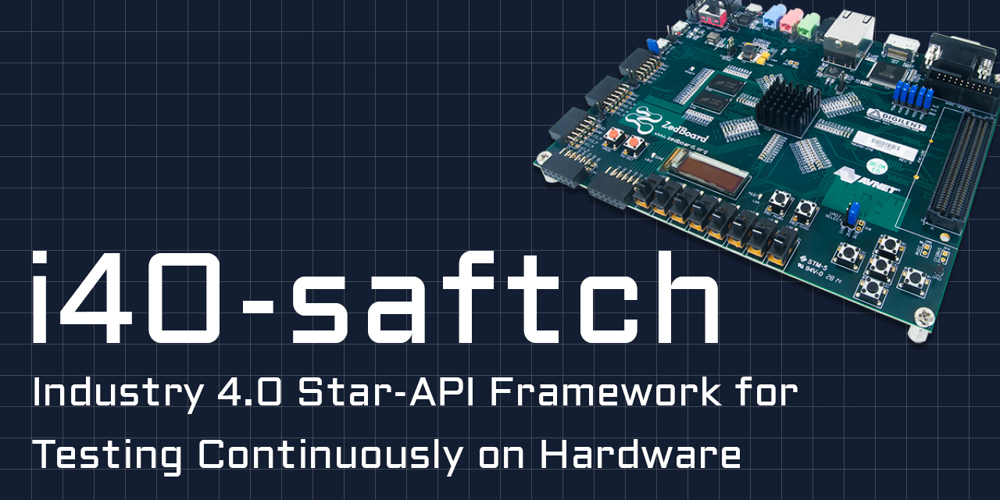

> [!IMPORTANT]  
> The repository is currently under construction! The release date for the `V0.1.0` is scheduled on the 10th November 2026. Thank you for your understanding.

# i40-saftch
Industry 4.0 Star-API Framework for Testing Continuously on Hardware

## Supported Hardware
Zedboard with:
- PYNQ 2.7 -> [Download via GoogleDrive](https://drive.google.com/file/d/1wlYzFai_k8tZG9Gg3gSle8tNcwy3PLxn/view?usp=sharing)
- Python 3.8.20
