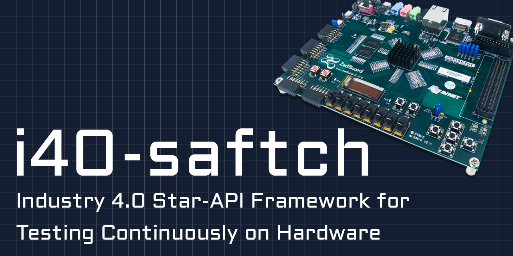

## 📖 Overview
**i40-SAFTCH** is an open-source, distributed Hardware-in-the-Loop (HIL) testing framework designed for Industry 4.0 environments. It provides a decentralized, hardware-independent environment to register, deploy, and continuously test hardware configurations across fleets of edge targets (such as FPGAs and SoC boards like the Zedboard) as if they were standard software components.

By utilizing Asset Administration Shells (AAS) as the Single Source of Truth, i40-SAFTCH operates on a highly scalable, decoupled architecture:
- **The FastAPI Proxy:** Abstracts complex, compute-heavy AAS semantics into ultra-lightweight JSON dictionaries and file responses.
- **Stateless HiLDaemons:** Target-specific edge daemons that utilize a secure "pull-down" execution model. This bypasses traditional inbound firewall restrictions and NAT traversal bottlenecks, allowing edge nodes to fetch lightweight test payloads based on their actual capacity.

## ⚡ Core Philosophies
This framework is built on three strict engineering principles:
1. **Left-Shifting:** Quality assurance and testing happen as early as possible.
2. **Fail Fast and Loudly:** Invalid states cause immediate halts with maximum visibility. Aiming for zero silent failures, especially at the hardware level. 
3. **Offensive Programming:** We assert internal contracts aggressively rather than writing endless defensive fallbacks.

## 🏗️ Repository Architecture
i40-SAFTCH is structured as a monorepo, divided into distinct scopes to cleanly separate the hardware edge from the cloud/proxy infrastructure:

- **`/edge`**: Contains the stateless HiLDaemons, hardware interfaces, and state machines running directly on the hardware targets (e.g., Zedboard/Zynq). These are custom-implemented per hardware family.
- **`/ssot`**: The Single Source of Truth. Contains the FastAPI proxy, AAS templates, and deployment configurations that manage the fleet of edge devices.
- **`/docs`**: Framework documentation, hardware specs, and repository governance (including our [Conventional Commits Cheat Sheet](docs/repository_governance/cheatsheet_conventional_commits.md)).
- **`/.github`**: CI/CD workflows for repository governance, issue templates, and automated pre-flight checks.

## 🚀 Getting Started

> [!NOTE]  
> This section is currently under construction. Setting up the entire toolchain (Single Source of Truth, Edge Daemon) of this framework is not a 10-minute task. *But* automation is on the way with later releases. If you want to know what is coming and/or want to help with the development, check out the [Issue Section](https://github.com/merlinseela/i40-saftch/issues) and [Contributing Guide](CONTRIBUTING.md)!