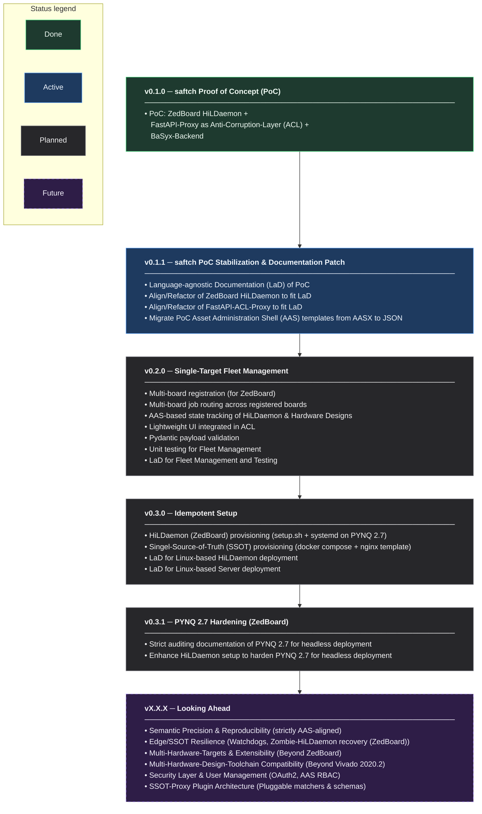

# i40-saftch Roadmap

> [!NOTE]
> This roadmap is a living document. It communicates the general direction and current baseline of the core maintainers and contributors, not a rigid schedule set in stone.
>
> Want to pull a feature forward, add support for another hardware target, or propose something not listed here? Contributions outside this baseline are explicitly welcome. Open a [Discussion](https://github.com/merlinseela/i40-saftch/discussions) to align before diving in.

| Status | Meaning | Release blocks |
| --- | --- | --- |
| Done | Completed work | v0.1.0 |
| Active | Work in progress | v0.1.1 |
| Planned | Work on the roadmap | v0.2.0, v0.3.0, v0.3.1 |
| Future | Work without a release version | Looking Ahead |

